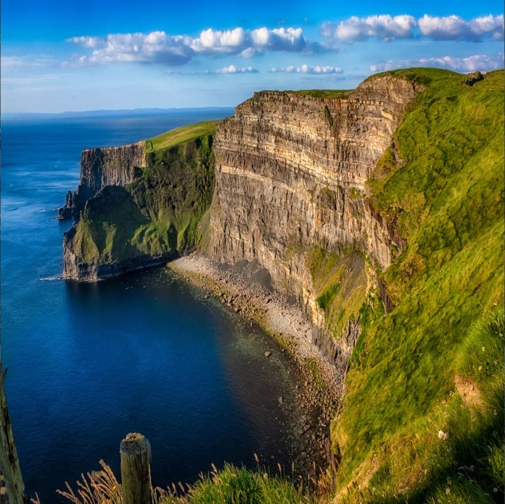
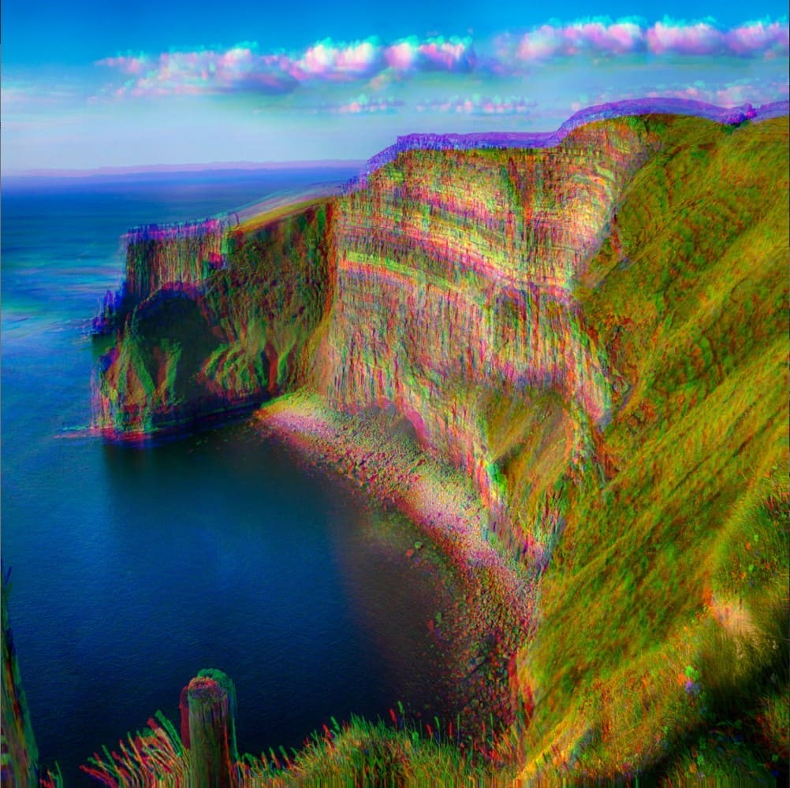

# Usage
Once p5.FIP has been included in your index.html file, to use an effect: 

1. In `createCanvas()`, use the WEBGL renderer ([Why?](https://p5js.org/reference/#/p5/shader)).
2. Load the shader you want, using `createFilterShader()`.
3. Set uniforms (parameters).
4. Call `filter()`, passing in the shader name.

```javascript hl_lines="8 9 18 21"
let ireland, glitch;

function preload() {
  ireland = loadImage("ireland.jpg");
}

function setup() {
    createCanvas(600, 600, WEBGL); // Use WEBGL mode to use the shader
    glitch = createFilterShader(fip.glitch); // Load the glitch shader
}
  
function draw() {
  background(0);
  imageMode(CENTER);
  image(bird, 0, 0, width, height);
      
  // Set the shader uniform(s)
  glitch.setUniform('glitchIntensity', 0.8); // Set the intensity of the glitch
  
  // Apply the shader
  filter(glitch);
}
```

<div style="display: flex;">
    <div style="margin-right: 5px;">
        
        <figcaption>Image with no effects</figcaption>
    </div>
    <div>
        
        <figcaption>Image with glitch effect applied</figcaption>
    </div>
</div>